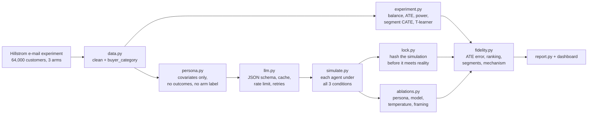

# AgentLift

[](https://github.com/dheepakkaran/agentlift/actions/workflows/ci.yml)

LLM customer agents re-run a real randomized e-mail experiment — one agent per sampled
customer, asked the same question once under each arm. The project then measures how
faithfully the simulated treatment effects reproduce the real ones, so you can see where
agent simulation is worth trusting before a real A/B test and where it is not.

## Pipeline



## Quickstart

```bash
python3.12 -m venv .venv
.venv/bin/pip install -r requirements.txt
.venv/bin/pip install -e .
cp .env.example .env    # add GROQ_API_KEY to run real agents
.venv/bin/python -m agentlift.cli all --quick --provider groq --track
```

Individual steps:

```bash
.venv/bin/python -m agentlift.cli real                       # real A/B analysis on all 64k rows
.venv/bin/python -m agentlift.cli simulate --quick --provider groq
.venv/bin/python -m agentlift.cli lock --quick --provider groq     # blind prediction lock
.venv/bin/python -m agentlift.cli evaluate --quick --provider groq
.venv/bin/python -m agentlift.cli ablate --quick --provider groq
.venv/bin/python -m agentlift.cli report --quick
```

`--provider mock` runs the whole pipeline offline with a deterministic stub provider. Mock
output goes to `results/mock/` and is never committed or reported.

## Reproduce without an API key

The simulated responses and every results file are committed, so the evaluation and the
dashboard run with no key and no network:

```bash
.venv/bin/python -m agentlift.cli evaluate --quick
.venv/bin/python -m streamlit run app/dashboard.py
```

## How the blind prediction works

The agents never see an outcome column, the real arm label, the dataset name or any base
rate — a test fails the build if a persona carries an outcome field. Before any comparison
with the real experiment, `lock` writes the SHA-256 of the simulation file, a UTC timestamp,
the config and the row count to `results/prediction_lock_{mode}.json`, and that lock is
committed. `evaluate` refuses to run if the lock is missing or the hash does not match, so
the prediction cannot be edited after seeing the answer.

Anchored results rescale the simulation so the simulated control rate equals the real one.
That uses real data, so it is reported separately and is explicitly not part of the blind
prediction.

## Project structure

```
src/agentlift/
  data.py         load and clean the Hillstrom experiment
  experiment.py   balance (SMD), ATE with CIs, power, segment CATE, T-learner
  persona.py      customer row -> second-person persona prompt
  llm.py          providers, JSON schema validation, SQLite cache, rate limiting
  simulate.py     stratified sample, each agent under all three conditions
  lock.py         blind prediction lock
  fidelity.py     simulated vs real: ATE error, ranking, segments, mechanism
  ablations.py    persona level, model size, temperature, prompt framing
  tracking.py     MLflow wrapper
  report.py       findings memo and the README results table
  cli.py          real | simulate | lock | evaluate | ablate | report | all
app/dashboard.py  Streamlit + Plotly, reads results/ only
results/          committed real-run summaries and simulated responses
reports/          findings memo
```

## Limitations

- The simulated sample is a few hundred customers against 64,000 real ones, so simulated
  confidence intervals are wide and small segments are skipped rather than reported.
- One dataset and one domain. E-mail response says nothing about pricing, UI or other channels.
- The Hillstrom data is public and may appear in the model's training data, which would
  flatter these results rather than hurt them.
- Anchored numbers use the real control rate and are a diagnostic, not a prediction.
- Conversion is reported for the real data only: it is too rare to measure in a small
  simulated sample, so visit is the primary outcome throughout.

## License

MIT — see [LICENSE](LICENSE). Author: Dheepak Karan Elumalai Santhakumari
([linkedin.com/in/dheepakkaran](https://linkedin.com/in/dheepakkaran)).
